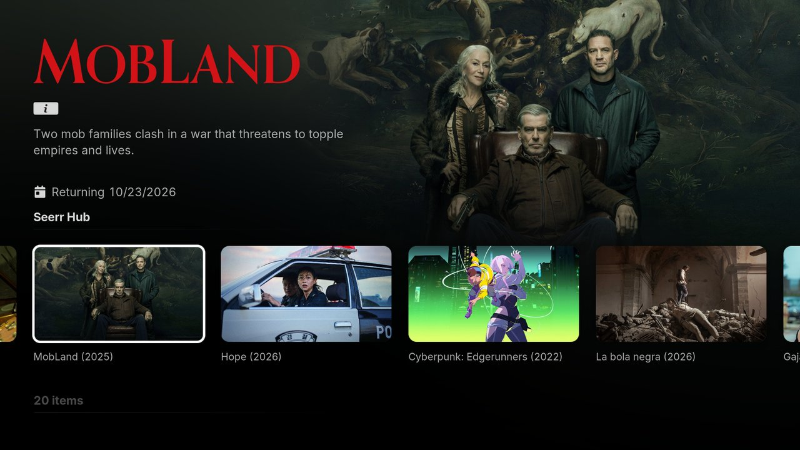
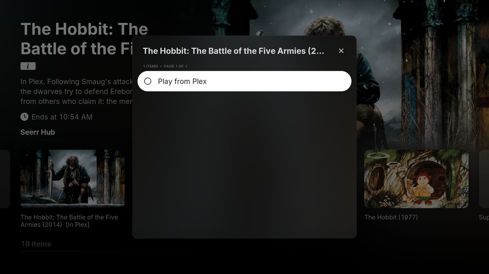
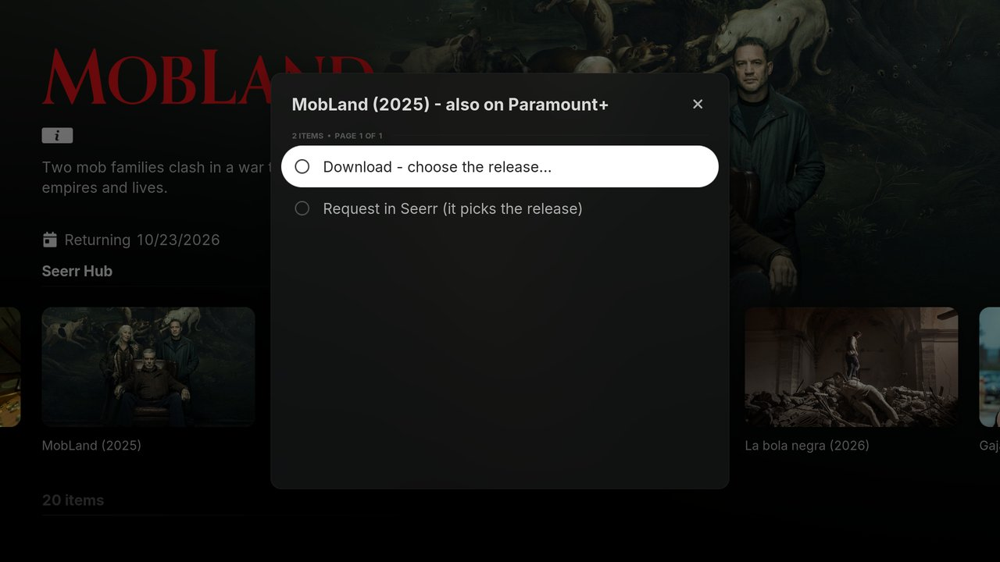
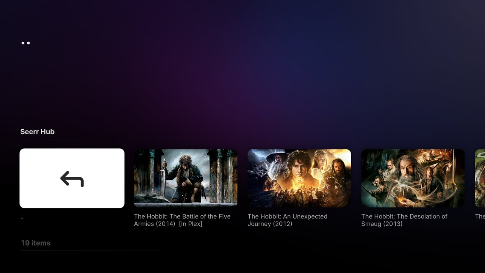
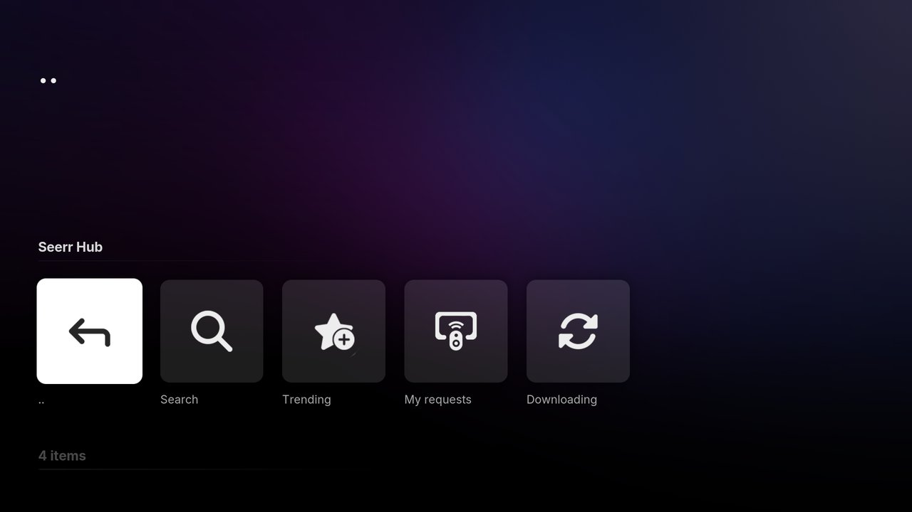
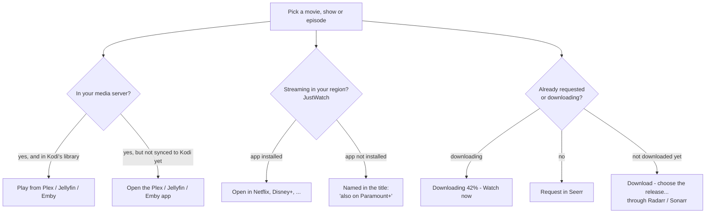
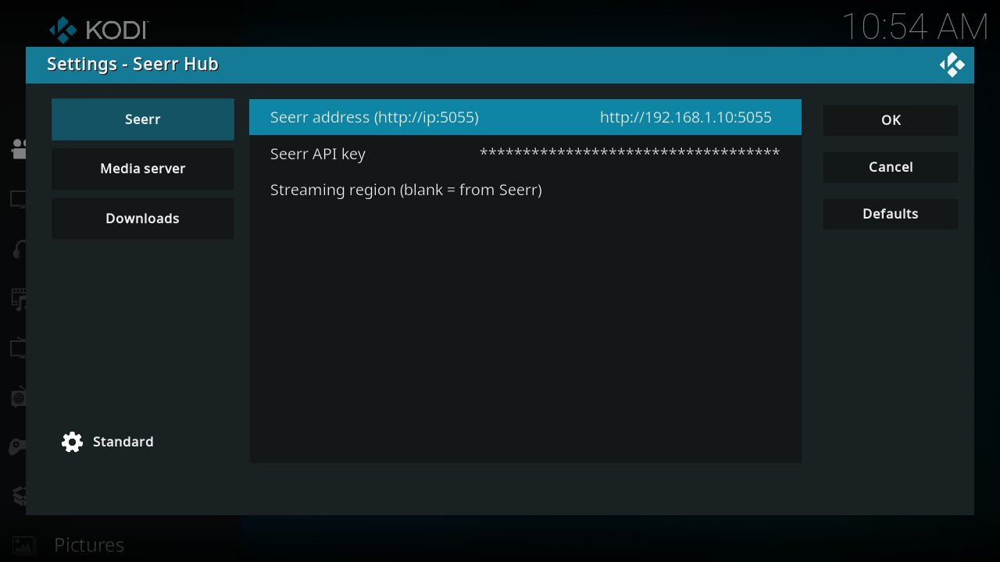

<p align="center">
  
</p>

<p align="center">
  <a href="https://github.com/Mooseca/plugin.video.seerrhub/releases/latest"></a>
  
  
  <a href="LICENSE"></a>
</p>

**Seerr Hub** is a Kodi add-on that answers one question for any movie or show: *"how do I watch this right now?"*

Pick a title and it checks your own media server, the streaming services you can get in your country, and your [Seerr](https://github.com/seerr-team/seerr) / Jellyseerr / Overseerr server. Then it gives you one short menu:

- **Play from Plex / Jellyfin / Emby** if it's already in your library
- **Open in Netflix / Disney+ / HBO Max / ...** if it's on a streaming service and the app is installed (Android TV)
- **Request in Seerr** if you don't have it, and let your Radarr/Sonarr setup fetch it
- *(optional)* **Download - choose the release** to pick the exact release yourself, then **start watching while it downloads**

It works as its own add-on, as a **"Watch or request"** item in Kodi's context menu, and as a **player for TMDb Helper**, so it plugs straight into skins like Arctic Fuse 3 ([example setup](#example-setup-arctic-fuse-3)).

<p align="center">
  
</p>

> [!NOTE]
> Seerr Hub doesn't stream or scrape anything. It opens apps you already have, plays files from your own server, and sends requests to your own Seerr.

---

## Contents

- [Screenshots](#screenshots)
- [How it decides what to offer](#how-it-decides-what-to-offer)
- [Requirements](#requirements)
- [Install](#install)
- [Quick start](#quick-start)
- [Settings in detail](#settings-in-detail)
- [Plex, Jellyfin and Emby](#plex-jellyfin-and-emby)
- [Downloads: pick a release and watch while it downloads](#downloads-pick-a-release-and-watch-while-it-downloads)
- [Using it from skins and TMDb Helper](#using-it-from-skins-and-tmdb-helper)
- [Example setup: Arctic Fuse 3](#example-setup-arctic-fuse-3)
- [Streaming apps](#streaming-apps)
- [Troubleshooting](#troubleshooting)
- [Privacy](#privacy)
- [Building and contributing](#building-and-contributing)

---

## Screenshots

| | |
|---|---|
|  |  |
| **In your library:** one click plays it from Plex. | **Not in your library:** it tells you where it streams, and offers download or request. |
|  |  |
| **Search** shows what you already have (`[In Plex]`, `[Requested]`, `[Downloading]`). | **Main menu:** Search, Trending, My requests, Downloading. |

*Screenshots are from Kodi 21 with the Arctic Fuse 3 skin on a PC. See [Example setup: Arctic Fuse 3](#example-setup-arctic-fuse-3) for how it's configured. On Android TV the same menu also lists "Open in Netflix" and so on.*

## How it decides what to offer



Everything that applies is listed together, best option first. Nothing is ever started without you choosing it.

## Requirements

| | Needed? | Notes |
|---|---|---|
| **Kodi 20 (Nexus) or newer** | Yes | Tested on Kodi 21 (Omega) on Android TV and Linux. |
| **Seerr, Jellyseerr or Overseerr** | Yes | You need its address and API key. |
| **Plex + [PlexKodiConnect](https://github.com/croneter/PlexKodiConnect)** | Optional | For "Play from Plex". |
| **Jellyfin / Emby** (+ [Jellyfin for Kodi](https://github.com/jellyfin/jellyfin-kodi)) | Optional | For "Play from Jellyfin". |
| **Radarr / Sonarr** | Optional | Already connected to Seerr. Lets you pick the release yourself. |
| **qBittorrent, Transmission or Deluge** | Optional | For watching while it downloads. Any other client (SABnzbd, NZBGet, rTorrent...) still shows up in the Downloading list through Radarr/Sonarr. |
| **Android TV device** | Optional | Only Android can open other apps. On other systems the "Open in ..." options are just left out. |

## Install

**From the Mooseca repository** (recommended: Kodi keeps it up to date by itself)

1. In Kodi, go to **Settings → System → Add-ons** and turn on **Unknown sources**.
2. Go to **Settings → File manager → Add source**, choose `<None>` and enter
   ```
   https://mooseca.github.io/repository.mooseca/
   ```
   then name it `mooseca`.
3. Go to **Settings → Add-ons → Install from zip file → mooseca** and pick `repository.mooseca-<version>.zip`.
4. Go to **Install from repository → Mooseca Repository → Video add-ons → Seerr Hub → Install**.
5. Open **Add-ons → Video add-ons → Seerr Hub → Configure** (or long-press → Settings).

**From a zip** (no automatic updates)

Download `plugin.video.seerrhub-<version>.zip` from the [latest release](https://github.com/Mooseca/plugin.video.seerrhub/releases/latest), turn on **Unknown sources** as above, then use **Install from zip file** on it. On a TV box it's often easiest to put the zip on a network share or USB stick. To update, install the newer zip the same way. Your settings are kept.

## Quick start

You only need two settings to get going:

1. **Seerr address**, e.g. `http://192.168.1.10:5055`
2. **Seerr API key**, from Seerr's web page: **Settings → General → API Key**

That's it. Leave **Media server** on *Ask Seerr*, and Seerr Hub uses whichever server Seerr is connected to. Open the add-on, try **Search** or **Trending**, and pick a title.

<p align="center">
  
</p>

## Settings in detail

### Seerr

| Setting | What to put | Example |
|---|---|---|
| Seerr address | The address you open Seerr on, including the port | `http://192.168.1.10:5055` |
| Seerr API key | Seerr → Settings → General → API Key | |
| Streaming region | Two-letter country code for streaming availability. **Leave blank** to use the region set in Seerr. | `US`, `GB`, `AU`, `CA` |

### Media server

| Setting | What it does |
|---|---|
| Media server | **Ask Seerr** (default) uses Seerr's own setting. You can force **Plex**, **Jellyfin**, **Emby** or **None** (no library: just streaming apps and requests). |
| Server address | Jellyfin / Emby only, e.g. `http://192.168.1.10:8096`. Leave blank to use the Jellyfin for Kodi login. |
| API key | Jellyfin: **Dashboard → API Keys → +**. Emby: **Settings → Advanced → API Keys**. |
| User name | The user whose watched status should be updated. Leave blank if there's only one user. |

### Downloads (optional)

| Setting | What to put | Example |
|---|---|---|
| Client | qBittorrent, Transmission or Deluge | |
| Web UI address | The client's Web UI. Default ports: qBittorrent 8080, Transmission 9091, Deluge 8112. | `http://192.168.1.10:9091` |
| User name / Password | qBittorrent / Transmission: leave blank if there's no login. Deluge only has a Web UI password (blank = Deluge's default, `deluge`). | |
| Download folder as Kodi sees it | The client's **default download folder**, shared to Kodi. Read-only is fine. Sub-folders (categories, labels) are worked out automatically. | `smb://nas/downloads/` or `nfs://nas/downloads/` |

| Your download client | Pick releases | Downloading list | Watch while it downloads |
|---|---|---|---|
| qBittorrent | Yes | Yes, with what's playable | Yes |
| Transmission 4.1+ | Yes | Yes, with what's playable | Yes |
| Transmission 4.0 or older | Yes | Yes, with what's playable | Yes, but it can't download in order, so it's usually ready later |
| Deluge 2 | Yes | Yes, with what's playable | Yes |
| Anything else (SABnzbd, NZBGet, rTorrent, ...), or leave the address blank | Yes | Yes, progress and time left from Radarr/Sonarr's queue | No |

You can still pick releases without any client set up, because Radarr/Sonarr send them to whatever download client they use.

## Plex, Jellyfin and Emby

Seerr Hub plays titles **from Kodi's own library**. That gives you normal Kodi playback, resume points and subtitles, and your media server stays the one source of truth.

### Plex

Install and sign in to **PlexKodiConnect**, and let it sync your libraries. Seerr Hub finds the title in the Kodi library that PlexKodiConnect builds, and uses PlexKodiConnect's login when it needs to talk to Plex. **There's nothing to fill in.**

### Jellyfin

Install **Jellyfin for Kodi** (from the Jellyfin repository) and sync your libraries. If it's signed in, Seerr Hub uses its login and you can leave the Jellyfin settings blank.

If you'd rather not use that add-on's login (or it's on a different user), fill in the **Server address**, **API key** and **User name** settings.

### Emby

This works the same way as Jellyfin, using **Emby for Kodi**. Emby goes through the same code as Jellyfin but **hasn't been tested on a real Emby server yet**. Reports welcome.

### Not in Kodi's library yet?

If Seerr says a title is available but your Kodi library hasn't caught up, the menu says *"In Plex - not in Kodi's library yet"*. On Android it offers to open the Plex / Jellyfin / Emby app instead.

## Downloads: pick a release and watch while it downloads

This part is optional, and is for people who already run Radarr and Sonarr behind Seerr. Watching while it downloads also needs qBittorrent, Transmission or Deluge.

### Choose the release

**Download - choose the release...** runs an interactive search in Radarr or Sonarr. These are the same servers, quality profile, root folder and tags that Seerr would use. You get a ranked list:

```
* WEBDL-2160p - 14.2 GB - 312 seeds          <- best pick
  Bluray-1080p - 9.8 GB - 84 seeds
  WEBDL-1080p - 4.1 GB - no seeds
x Remux-2160p - 61.0 GB - 40 seeds           <- outside your profile
```

Pick one to see the details (indexer, MB per minute against your size settings, bitrate, custom formats, and why Radarr/Sonarr would reject it) before you send it.

Releases are ranked by:

| | Weight | |
|---|---|---|
| Quality | 30% | Where it sits in your quality profile |
| Seeders | 30% | Full marks at 200+ |
| Size | 20% | How close it is to the *preferred* size in Radarr/Sonarr (MB per minute) |
| Custom formats | 15% | Your custom format score |
| Streamable | 5% | Fits under your torrent client's download speed limit, if you set one |

Releases with no seeders are pushed far down, and releases Radarr/Sonarr would reject always sort below the ones they'd accept. For TV, season packs come first, then each episode's releases in order (the episode you asked for at the very top), with the best one for each episode starred. When a torrent client is set up, only torrents are listed, since watching while downloading needs one.

Once you pick a release, it goes to Radarr/Sonarr, so they import and rename it as usual. If the title isn't in Radarr/Sonarr yet, it's added first, without an automatic search. With a torrent client set up, Seerr Hub then waits for the torrent to appear and offers to watch it.

### Watch while it downloads

When you start watching a download, Seerr Hub:

1. switches the torrent to **sequential download** (in qBittorrent and Deluge, first and last pieces first too) and starts it if it was queued or paused
2. works out how much of the file is on disk **from the start, with no gaps**, and how fast it's downloading
3. offers **Watch now** once the download is safely ahead of playback (20% margin, at least 90 seconds buffered), or **Start by itself when it's safe**, with a live progress window

The **Downloading** list shows every active download with progress and *Watch now* / *Ready in ~12 min* / *Stalled*. Without a torrent client set up it shows Radarr/Sonarr's queue instead: progress and *done in ~25 min*, for any download client including usenet.

### Watched status is kept

Kodi's media server never sees playback of a file straight from the downloads folder. So Seerr Hub remembers how far you got. Every 10 minutes it checks, and once Radarr/Sonarr have imported the file and it shows up in Plex / Jellyfin / Emby, it marks it **watched** (past 90%) or saves your **resume point** there. Titles that never turn up are forgotten after 30 days.

## Using it from skins and TMDb Helper

### Context menu

Every movie, show, season and episode in Kodi gets a **Watch or request (Seerr Hub)** context-menu item. This covers library items, TMDb Helper lists and skin widgets.

### TMDb Helper player

Copy [`seerrhub.json`](seerrhub.json) to:

```
userdata/addon_data/plugin.video.themoviedb.helper/players/
```

**Seerr Hub** then shows up as a player in TMDb Helper. To make every *Play* button in a TMDb Helper-based skin (Arctic Fuse, Arctic Horizon...) go through Seerr Hub, set it as the default player for movies and episodes in TMDb Helper's settings.

### Skin widgets

Any Seerr Hub folder works as a widget:

| Widget | Path |
|---|---|
| Trending | `plugin://plugin.video.seerrhub/?action=trending` |
| My requests | `plugin://plugin.video.seerrhub/?action=requests` |
| Downloading | `plugin://plugin.video.seerrhub/?action=downloads&reload=$INFO[Window(Home).Property(seerrhub.downloads)]` |

The `reload=` part on the Downloading widget keeps it up to date: while something is downloading, the add-on changes that property every 30 seconds, which makes the skin reload the widget.

### Search button

For a skin menu item that opens the Seerr Hub search keyboard straight away:

```
RunPlugin(plugin://plugin.video.seerrhub/?action=ask)
```

### Other links

| Action | Path |
|---|---|
| Open the menu for a movie | `plugin://plugin.video.seerrhub/?action=open&type=movie&tmdb_id=122917` |
| ...for an episode | `plugin://plugin.video.seerrhub/?action=open&type=tv&tmdb_id=1396&season=1&episode=1` |
| Search with a word already filled in | `plugin://plugin.video.seerrhub/?action=search&query=hobbit` |

## Example setup: Arctic Fuse 3

The screenshots come from **[Arctic Fuse 3](https://github.com/jurialmunkey/skin.arctic.fuse.3)** (with TMDb Helper and skinvariables, which it installs). Here's how Seerr Hub is wired into it, so you can copy the setup.

**1. Every Play button goes through Seerr Hub.** In TMDb Helper's settings, the default player is set to Seerr Hub for both movies and episodes (see [TMDb Helper player](#tmdb-helper-player)). Pressing Play on anything in the skin, whether it's in your library or not, opens the Seerr Hub menu. TMDb Helper's built-in players are turned off, so it doesn't ask which player to use.

**2. A "Search & Request" item in the menus.** In the home, Movies, TV Shows and Discover sub-menus, an item labelled *Search & Request*, with the skin's magnifying-glass icon, runs:

```
RunPlugin(plugin://plugin.video.seerrhub/?action=ask)
```

**3. Widgets.** These are set in Arctic Fuse 3's menu and widget editor, using *Poster* style for the title rows:

| Menu | Widgets (in order) |
|---|---|
| **Home** | Continue Watching, Next Episodes, **Downloading** *(Seerr Hub)*, New Movies, New Episodes, **Trending** *(Seerr Hub)*, **My Requests** *(Seerr Hub)* |
| **Movies** | Your library (Continue Watching, Recently Added, Unwatched, ...) + TMDb Helper *Trending This Week* |
| **TV Shows** | Your library (Next Episodes, New Episodes, ...) + TMDb Helper *Trending This Week* |
| **Discover** *(an extra menu item)* | **Trending Now** *(Seerr Hub)*, then "Popular on Netflix / Disney+ / Prime Video / ..." rows, **Downloading**, **My Requests** |

The Discover sub-menu also has *Downloading* and *My Requests* as full-screen lists:

```
ActivateWindow(videos,plugin://plugin.video.seerrhub/?action=downloads,return)
ActivateWindow(videos,plugin://plugin.video.seerrhub/?action=requests,return)
```

The "Popular on ..." rows are TMDb Helper's discover lists, filtered to one streaming service in your region. For example, Netflix (TMDb provider 8) in the US:

```
plugin://plugin.video.themoviedb.helper/?info=discover&tmdb_type=tv&with_watch_providers=8&watch_region=US
```

Because Play goes through Seerr Hub, picking anything in those rows offers **Open in Netflix** on Android TV. If the title is already in your library, it offers **Play from Plex** instead.

**4. App shortcuts (Android TV).** The home sub-menu also has plain launch items for the streaming apps (`StartAndroidActivity(com.netflix.ninja)` and so on), and one for the Plex app.

## Streaming apps

Seerr Hub uses [JustWatch](https://www.justwatch.com) data to see which services have a title **in your region**. On Android it opens the official app straight to that title, if the app is installed.

| Region | Apps |
|---|---|
| Worldwide | Netflix, Prime Video, Disney+, HBO Max, Apple TV+, Paramount+, YouTube, Crunchyroll, MUBI |
| US / Canada | Hulu, Peacock, Tubi, Pluto TV, Crave |
| UK | BBC iPlayer, ITVX |
| Australia | Stan, Binge, Kayo, ABC iview, SBS On Demand, 9Now, 7plus, 10 Play |

Services that aren't in this list, or whose app isn't installed, are still named in the menu title, e.g. *"also on Paramount+"*.

**Adding an app** takes one line in `resources/lib/api.py` (`SERVICES`): the JustWatch name, the display name, the Android package name, and whether to open the web link or the app link. Pull requests welcome.

## Troubleshooting

<details>
<summary><b>The "Open in Netflix" (etc.) option doesn't show up</b></summary>

- Only Android can open other apps. On Windows, Linux and macOS the service is named in the title instead.
- The app has to be installed, and the title has to be on that service **in your region**. Check the Streaming region setting, or the region in Seerr.
</details>

<details>
<summary><b>"In Plex - not in Kodi's library yet"</b></summary>

Seerr knows the title is on your server, but PlexKodiConnect / Jellyfin for Kodi hasn't synced it into Kodi yet. Wait for the next sync, or start one from that add-on.
</details>

<details>
<summary><b>"Kodi can't see the downloads folder yet" / downloads won't play</b></summary>

Set **Download folder as Kodi sees it** to the torrent client's *default download folder* (qBittorrent: default save path; Transmission: download directory; Deluge: download to), as a share Kodi can open. Test it first in Kodi's file manager. For example, the client saves to `/data/downloads` and the NAS shares that folder as `smb://nas/downloads/`.
</details>

<details>
<summary><b>"... wants a login" / "refused the login"</b></summary>

- **qBittorrent:** fill in the user name and password, or allow your network: **Options → Web UI → Bypass authentication for clients in whitelisted IP subnets**.
- **Transmission:** fill in the RPC user name and password. If it still refuses, add Kodi's address to `rpc-whitelist` in Transmission's `settings.json` (or turn the whitelist off), with Transmission stopped.
- **Deluge:** put the Web UI password in *Password*. The Web UI must be connected to a daemon. Seerr Hub connects it to the first one in the Web UI's Connection Manager if it isn't.
</details>

<details>
<summary><b>Transmission: "as fast as it can" instead of "in order"</b></summary>

Downloading in order needs Transmission 4.1 or newer. Older versions still work, but the start of the file arrives in random order, so *Watch now* comes later, often near the end.
</details>

<details>
<summary><b>Watched status isn't copied to Jellyfin</b></summary>

Check that Jellyfin for Kodi is signed in, or fill in the Jellyfin settings. Seerr Hub needs a user to update. If you use an API key with several users on the server, set **User name**.
</details>

<details>
<summary><b>Where are the logs?</b></summary>

In Kodi's log (`kodi.log`). Every line from this add-on starts with `[seerrhub]`, and watched-status sync lines start with `[seerrhub] sync:`.
</details>

## Privacy

Seerr Hub only talks to:

- **your own servers**: Seerr, and if you set them up, Plex / Jellyfin / Emby, Radarr / Sonarr (through Seerr's settings) and your torrent client
- **JustWatch's public API**, to look up where a title streams (title name + region only)
- **TMDb's image server**, for posters

There's no account, no tracking and no analytics. API keys stay in Kodi's settings on your device.

## Building and contributing

```sh
git clone https://github.com/Mooseca/plugin.video.seerrhub
cd plugin.video.seerrhub
python3 build.py        # -> plugin.video.seerrhub-<version>.zip
```

Releases go out as a GitHub release and through the [Mooseca repository](https://github.com/Mooseca/repository.mooseca) (`python3 build.py <zip>` there, then push).

The add-on is plain Python with no extra dependencies:

| File | What's in it |
|---|---|
| `default.py` | Menus and lists (Search, Trending, My requests, Downloading) |
| `context.py` | The "Watch or request" context-menu item |
| `service.py` | Background service: watched-status sync and the Downloading widget refresh |
| `resources/lib/hub.py` | The title menu, release picker and watch-while-downloading |
| `resources/lib/api.py` | Seerr, JustWatch, Radarr/Sonarr, qBittorrent / Transmission / Deluge clients, and release ranking |
| `resources/lib/mediasync.py` | Watched / resume-point sync to Plex, Jellyfin and Emby |

Bug reports and pull requests are welcome, especially from **Emby** users and from regions whose streaming apps aren't mapped yet.

## Credits

Built on the work of [Seerr](https://github.com/seerr-team/seerr) / Overseerr / Jellyseerr, [PlexKodiConnect](https://github.com/croneter/PlexKodiConnect), [Jellyfin for Kodi](https://github.com/jellyfin/jellyfin-kodi), [TMDb Helper](https://github.com/jurialmunkey/plugin.video.themoviedb.helper), and the streaming data from [JustWatch](https://www.justwatch.com). Not affiliated with any of them, or with any streaming service.

## License

[MIT](LICENSE)
